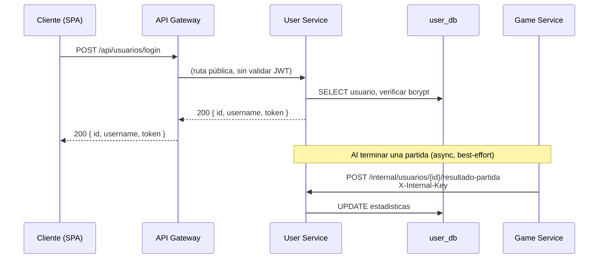
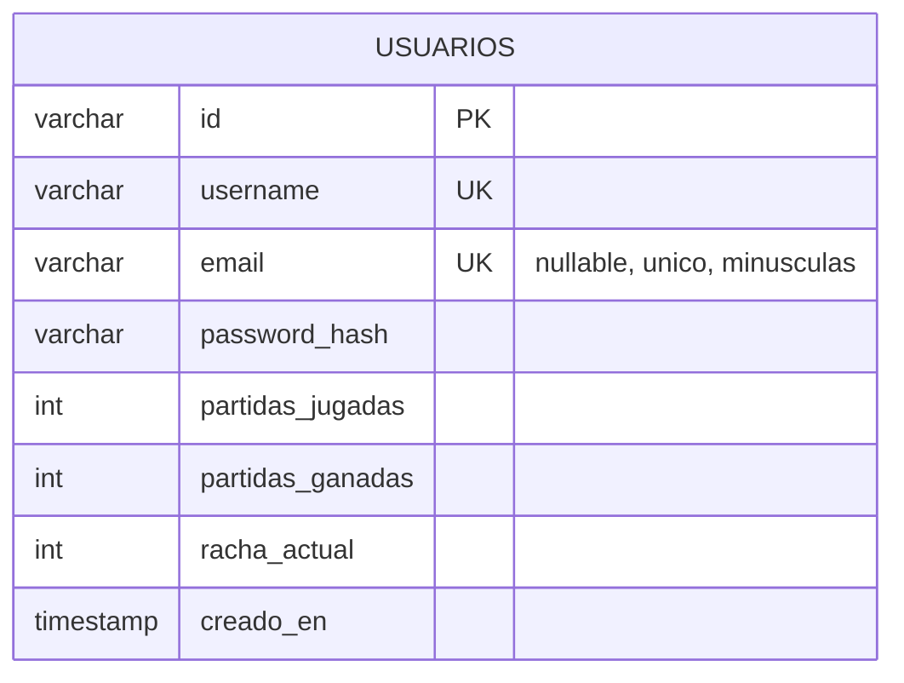

# User Service

> Autenticación, invitados y estadísticas de jugador — microservicio de **UNO Power-Ups Arena**.

[](https://github.com/UNO-POWER/UserService/actions/workflows/ci.yml)
[]()
[]()
[]()
[]()

---

## Tabla de contenidos

1. [Descripción](#1-descripción)
2. [Arquitectura](#2-arquitectura)
3. [Tecnologías](#3-tecnologías)
4. [Requisitos](#4-requisitos)
5. [Instalación](#5-instalación)
6. [Configuración](#6-configuración)
7. [Ejecución](#7-ejecución)
8. [Estructura del proyecto](#8-estructura-del-proyecto)
9. [Flujo interno](#9-flujo-interno)
10. [API](#10-api)
11. [Base de datos](#11-base-de-datos)
12. [Seguridad](#12-seguridad)
13. [Logs](#13-logs)
14. [Observabilidad](#14-observabilidad)
15. [Testing](#15-testing)
16. [Despliegue](#16-despliegue)
17. [Solución de problemas](#17-solución-de-problemas)
18. [Roadmap](#18-roadmap)
19. [Contribución](#19-contribución)
20. [Licencia](#20-licencia)
21. [Autor](#21-autor)

---

## 1. Descripción

**User Service** es el microservicio responsable de la identidad del jugador en UNO Power-Ups
Arena: registro y login con contraseña, acceso como **invitado** sin registro, emisión de **JWT**
firmado, y persistencia de **estadísticas** (partidas jugadas, ganadas y racha actual).

No tiene UI propia: es consumido por el [API Gateway](../APIGATEWAY) (rutas públicas `/api/usuarios/**`)
y notificado internamente por el [Game Service](../GameService) al terminar cada partida.

### Historias de usuario que implementa

| HU / EC | Descripción | Endpoint |
|---|---|---|
| **HU-06** | Registrar cuenta y autenticarse con JWT | `POST /api/usuarios/registro`, `/login` |
| **EC-07** | Jugar sin registro obligatorio (invitado) | `POST /api/usuarios/guest` |
| **HU-07** | Ver estadísticas personales (jugadas, ganadas, racha) | `GET /api/usuarios/me/stats` |
| **EC-05** | Contraseñas con bcrypt, JWT autoritativo | transversal (ver [§12](#12-seguridad)) |

### Responsabilidad exacta

- Emitir JWT firmado con `HS512`, compartido (mismo secreto) con el API Gateway y el Game Service,
  para que **cualquiera** de los tres pueda validar la identidad de un jugador sin llamarse entre sí.
- Ser la **única** fuente de verdad de credenciales y estadísticas — nunca se replican en otro
  servicio; Game Service solo *notifica* resultados, no los guarda.
- Resolver el conflicto entre "jugar sin registro" (EC-07) y "JWT autoritativo en todo el sistema"
  (EC-05) emitiendo un JWT también para invitados, con una identidad efímera no persistida.

### Cómo interactúa con los demás servicios



---

## 2. Arquitectura

Ubicación dentro del sistema (ver [arquitectura completa](../README.md#3-arquitectura)):

```
                    ┌──────────────┐
   Internet ──────▶ │ API Gateway  │  (valida JWT, enruta /api/usuarios/**)
                    └──────┬───────┘
                           │ REST + X-User-Id + X-Trace-Id
                           ▼
                    ┌──────────────┐        ┌──────────────┐
                    │ User Service │◀───────│ Game Service │  (resultado de partida,
                    │   :8081      │  async  │   :8083      │   X-Internal-Key)
                    └──────┬───────┘         └──────────────┘
                           │ JDBC
                           ▼
                    ┌──────────────┐
                    │  user_db      │  (schema propio en PostgreSQL)
                    └──────────────┘
```

**Capas internas** (arquitectura hexagonal ligera dentro del microservicio):

```
Controller (REST)  →  Service (reglas de negocio)  →  Repository (Spring Data JPA)  →  PostgreSQL
       │                      │
       └── DTO (request/response) ──── Model (entidad JPA)
```

No depende de ningún otro microservicio para operar: puede caerse Lobby o Game Service y
User Service sigue respondiendo login/registro con normalidad (aislamiento de fallos, EC-04).

---

## 3. Tecnologías

| Tecnología | Versión | Uso |
|---|---|---|
| Java | 21 | Lenguaje |
| Spring Boot | 3.2.5 | Framework |
| Spring Web (MVC) | incluido en Boot 3.2.5 | Controllers REST |
| Spring Data JPA | incluido en Boot 3.2.5 | Persistencia |
| Spring Boot Validation | incluido en Boot 3.2.5 | `@Valid` en DTOs |
| Spring Boot Actuator | incluido en Boot 3.2.5 | Health, métricas |
| Micrometer + Prometheus registry | incluido en Boot 3.2.5 | Exposición `/actuator/prometheus` |
| PostgreSQL Driver | incluido en Boot 3.2.5 | JDBC |
| jjwt (`io.jsonwebtoken`) | 0.12.6 | Firma/emisión de JWT (HS512) |
| Spring Security Crypto | incluido en Boot 3.2.5 | `BCryptPasswordEncoder` (sin el filter chain completo) |
| Logstash Logback Encoder | 7.4 | Logs JSON estructurados |
| JUnit 5 + Mockito | incluido en Boot 3.2.5 | Testing |
| JaCoCo | 0.8.12 | Cobertura de tests |
| Maven | 3.9+ | Build |
| Docker | multi-stage (`maven:3.9-eclipse-temurin-21` → `eclipse-temurin:21-jre-alpine`) | Empaquetado |

---

## 4. Requisitos

- **Java 21** (JDK, no solo JRE) — verificar con `java -version`.
- **Maven 3.9+** (o usar el wrapper si se agrega; este proyecto usa Maven del sistema).
- **PostgreSQL 16** accesible (local, Docker, o RDS) con el schema `user_db` creado.
- **Docker** (opcional, para build en contenedor).
- Variables de entorno de la [sección 6](#6-configuración) — todas tienen valor por defecto para
  desarrollo local excepto ninguna es estrictamente obligatoria salvo que se despliegue en producción
  (ver tabla).

No requiere Node, ni AWS CLI, ni ningún otro servicio del sistema para arrancar en aislamiento
(puede iniciarse con solo Postgres corriendo).

---

## 5. Instalación

Desde cero, sin asumir que ya clonaste nada:

```bash
# 1. Clonar el repositorio
git clone https://github.com/UNO-POWER/UserService.git
cd UserService

# 2. Verificar Java 21
java -version   # debe imprimir "21" en la primera línea

# 3. Levantar un Postgres local para desarrollo (si no tenés uno)
docker run -d --name uno-postgres-dev \
  -e POSTGRES_USER=uno -e POSTGRES_PASSWORD=uno -e POSTGRES_DB=uno \
  -p 5432:5432 postgres:16-alpine

# 4. Crear el schema user_db (una sola vez)
docker exec -i uno-postgres-dev psql -U uno -d uno -c "CREATE SCHEMA IF NOT EXISTS user_db;"

# 5. Compilar y descargar dependencias
mvn -q -DskipTests package

# 6. Ejecutar los tests (opcional pero recomendado)
mvn test
```

Si todo lo anterior corrió sin errores, el JAR queda en `target/userservice-0.1.0.jar`.

---

## 6. Configuración

Todas las variables se leen vía `${VARIABLE:valor-por-defecto}` en
[`application.yml`](src/main/resources/application.yml) — funcionan sin configurar nada en
desarrollo local, pero **deben** sobrescribirse en producción.

| Variable | Obligatoria en prod | Valor por defecto (dev) | Descripción |
|---|---|---|---|
| `SPRING_DATASOURCE_URL` | ✅ | `jdbc:postgresql://localhost:5432/uno?currentSchema=user_db` | JDBC hacia PostgreSQL, con el schema propio |
| `SPRING_DATASOURCE_USERNAME` | ✅ | `uno` | Usuario de la BD |
| `SPRING_DATASOURCE_PASSWORD` | ✅ | `uno` | Contraseña de la BD |
| `JWT_SECRET` | ✅ | secreto de ejemplo (inseguro) | Clave HS512 **compartida** con API Gateway y Game Service. Generar con `openssl rand -base64 48` |
| `JWT_EXPIRATION_MS` | ❌ | `86400000` (24 h) | Vigencia del token emitido |
| `INTERNAL_API_KEY` | ✅ | clave de ejemplo (inseguro) | Protege `/internal/**`; debe coincidir con la que usa Game Service al llamar |
| `SERVER_PORT` (implícito, `server.port`) | ❌ | `8081` | Puerto HTTP |

> ⚠️ En producción, si `JWT_SECRET` no coincide exactamente entre este servicio, el Gateway y el
> Game Service, **todos los tokens emitidos aquí serán rechazados** por los otros dos.

---

## 7. Ejecución

### Desarrollo (con Postgres local)

```bash
mvn spring-boot:run
```

Con variables de entorno explícitas (ejemplo real usado durante desarrollo de este proyecto):

```bash
SPRING_DATASOURCE_URL="jdbc:postgresql://localhost:5432/uno?currentSchema=user_db" \
SPRING_DATASOURCE_USERNAME=uno SPRING_DATASOURCE_PASSWORD=uno \
JWT_SECRET="un-secreto-largo-y-aleatorio" \
INTERNAL_API_KEY="otra-clave-larga-y-aleatoria" \
mvn spring-boot:run
```

Verificar que arrancó:

```bash
curl http://localhost:8081/actuator/health
# {"status":"UP","components":{"db":{"status":"UP", ...
```

### Producción (JAR)

```bash
mvn -q -DskipTests package
java -jar target/userservice-0.1.0.jar
```

### Docker (imagen individual)

```bash
docker build -t uno-user-service .
docker run -p 8081:8081 \
  -e SPRING_DATASOURCE_URL="jdbc:postgresql://host.docker.internal:5432/uno?currentSchema=user_db" \
  -e SPRING_DATASOURCE_USERNAME=uno -e SPRING_DATASOURCE_PASSWORD=uno \
  -e JWT_SECRET="..." -e INTERNAL_API_KEY="..." \
  uno-user-service
```

### Docker Compose (stack completo)

Este servicio **no se levanta solo** en producción real — forma parte del
[`docker-compose.yml`](../docker-compose.yml) raíz junto a los otros 5 servicios. Ver la
[guía de infraestructura](../deploy/README.md) para el paso a paso completo.

```bash
# desde la carpeta raíz del proyecto (que contiene los 6 repos)
docker compose up -d --build user-service
```

---

## 8. Estructura del proyecto

```
UserService/
├── src/main/java/com/unopower/userservice/
│   ├── UserServiceApplication.java   # punto de entrada Spring Boot
│   ├── config/
│   │   ├── AppConfig.java            # bean PasswordEncoder (BCrypt) + habilita JwtProperties
│   │   ├── JwtProperties.java        # binding de jwt.secret / jwt.expiration-ms
│   │   └── InternalApiKeyFilter.java # exige X-Internal-Key en /internal/**
│   ├── controller/
│   │   ├── UsuarioController.java         # /api/usuarios/** (público vía Gateway)
│   │   └── UsuarioInternalController.java # /internal/usuarios/** (solo Game Service)
│   ├── service/
│   │   ├── UsuarioService.java             # registrar, login, guest, stats, resultado-partida
│   │   ├── JwtIssuer.java                  # firma el JWT (HS512) con claims sub/username/guest
│   │   ├── UsernameYaExisteException.java  # 409
│   │   ├── CredencialesInvalidasException.java # 401
│   │   └── UsuarioNoEncontradoException.java   # 404
│   ├── model/
│   │   └── Usuario.java              # entidad JPA (tabla `usuarios`)
│   ├── repository/
│   │   └── UsuarioRepository.java    # Spring Data JPA
│   ├── dto/                          # records: RegistroRequest, LoginRequest, GuestRequest,
│   │                                 # AuthResponse, EstadisticasResponse, ResultadoPartidaRequest
│   └── web/
│       └── GlobalExceptionHandler.java  # mapea excepciones de dominio a códigos HTTP
├── src/main/resources/
│   ├── application.yml       # toda la configuración (ver §6)
│   └── logback-spring.xml    # logs JSON con trace-id (ver §13)
├── src/test/java/…/service/
│   └── UsuarioServiceTest.java   # 11 tests (ver §15)
├── Dockerfile                 # build multi-stage Maven → JRE Alpine
└── pom.xml
```

---

## 9. Flujo interno

### Registro (`POST /api/usuarios/registro`)

1. `UsuarioController` recibe el body y lo valida con `@Valid` (`RegistroRequest`: username 3-40
   chars, password 6-100 chars). Si falla, `GlobalExceptionHandler` responde `400`.
2. `UsuarioService.registrar()` comprueba `existsByUsername` — si ya existe, lanza
   `UsernameYaExisteException` → `409`.
3. La contraseña se cifra con `BCryptPasswordEncoder` (nunca se guarda en claro).
4. Se persiste el `Usuario` (JPA genera el `id` como UUID).
5. `JwtIssuer` firma un JWT (`sub`=id, claim `username`, claim `guest:false`, `exp` = ahora +
   `JWT_EXPIRATION_MS`).
6. Responde `201` con `{ id, username, token }`.

### Login (`POST /api/usuarios/login`)

Busca por `username`, compara con `passwordEncoder.matches(...)`. Si el usuario no existe **o** la
contraseña no coincide, lanza la **misma** excepción (`CredencialesInvalidasException` → `401`) en
ambos casos — evita que un atacante deduzca qué usernames existen (no hay enumeración de usuarios).

### Invitado (`POST /api/usuarios/guest`)

No toca la base de datos. Genera un `id` sintético `guest-<uuid>` y firma un JWT con claim
`guest:true`. Este token es válido para el resto del sistema (Gateway y Game Service lo aceptan
igual que uno de cuenta real), pero **no** existe fila en `usuarios` — por eso
`GET /me/stats` para un invitado responde `404` (ver §10).

### Resultado de partida (`POST /internal/usuarios/{userId}/resultado-partida`)

Llamado por Game Service al terminar una partida (best-effort, con reintento de su lado si falla).
`InternalApiKeyFilter` exige el header `X-Internal-Key` — si no coincide, `403` sin llegar al
controller. Si el `userId` no existe en `user_db` (era un invitado), la operación es un **no-op
silencioso** (200, nada que actualizar) — no es un error, es el comportamiento esperado.

---

## 10. API

Todos los endpoints bajo `/api/usuarios/**` se acceden **a través del API Gateway**
(`http://localhost:18080` en local, o el dominio de producción) — no directamente al puerto 8081
salvo en desarrollo aislado. Los `/internal/**` solo deben ser llamados por otros servicios.

### `POST /api/usuarios/registro`

Crea una cuenta (username + correo) y devuelve un JWT.

- **Autenticación:** ninguna (ruta pública)
- **Headers:** `Content-Type: application/json`

**Body:**
```json
{ "username": "ana", "email": "ana@mail.com", "password": "secreto123" }
```

El correo se normaliza a minúsculas antes de guardarse y debe ser único.

**Respuesta `201 Created`:**
```json
{
  "id": "3796e987-1f8f-446f-92c5-3564803644a3",
  "username": "ana",
  "token": "eyJhbGciOiJIUzUxMiJ9..."
}
```

**Errores:**

| Código | Causa | Body |
|---|---|---|
| `400` | username/email/password no cumplen `@Valid` | `{ "error": "username: size must be between 3 and 40" }` |
| `409` | username ya existe | `{ "error": "El usuario 'ana' ya existe" }` |
| `409` | correo ya registrado | `{ "error": "Ya existe una cuenta con el correo 'ana@mail.com'" }` |

---

### `POST /api/usuarios/login`

Login **dual**: el campo `username` acepta el nombre de usuario **o** el correo registrado.

- **Autenticación:** ninguna (ruta pública)

**Body (cualquiera de las dos formas):**
```json
{ "username": "ana", "password": "secreto123" }
```
```json
{ "username": "ana@mail.com", "password": "secreto123" }
```

**Respuesta `200 OK`:** igual forma que registro (`{ id, username, token }`).

**Errores:**

| Código | Causa |
|---|---|
| `401` | usuario/correo no existe o contraseña incorrecta (mismo mensaje en ambos casos) |

---

### `POST /api/usuarios/guest`

Emite un JWT para jugar sin cuenta (EC-07).

- **Autenticación:** ninguna (ruta pública)

**Body:**
```json
{ "nombre": "Visitante" }
```

**Respuesta `201 Created`:**
```json
{ "id": "guest-0643fd90-375a-43a3-b69c-93438f7339f9", "username": "Visitante", "token": "eyJ..." }
```

El JWT lleva claim `"guest": true`. No se persiste ningún dato.

---

### `GET /api/usuarios/me/stats`

Estadísticas del usuario autenticado (HU-07).

- **Autenticación:** **requerida** — el API Gateway ya validó el JWT y propaga el header
  `X-User-Id` (el servicio no vuelve a parsear el token, confía en el Gateway).
- **Headers esperados:** `X-User-Id: <uuid>` (lo pone el Gateway automáticamente)

**Respuesta `200 OK`:**
```json
{ "username": "ana", "partidasJugadas": 12, "partidasGanadas": 5, "rachaActual": 2 }
```

**Errores:**

| Código | Causa |
|---|---|
| `404` | el `userId` no existe en `user_db` — típicamente porque es un invitado sin cuenta |
| `400` | falta el header `X-User-Id` (solo ocurre si se llama directo al servicio, sin pasar por el Gateway) |

---

### `PATCH /api/usuarios/me`

Cambia el nombre de usuario (Configuración del perfil). La respuesta incluye un **JWT re-emitido**
con el claim `username` actualizado — el cliente debe adoptarlo como sesión nueva, porque el token
anterior seguiría mostrando el nombre viejo en chat/roster.

- **Autenticación:** **requerida** (vía Gateway → `X-User-Id`)

**Body:**
```json
{ "username": "ana_renombrada" }
```

**Respuesta `200 OK`:** `{ id, username, token }` (token nuevo).

**Errores:**

| Código | Causa |
|---|---|
| `409` | el username nuevo ya está tomado por otra cuenta |
| `404` | el `userId` es de un invitado (no persistido): los invitados no tienen perfil editable |
| `400` | username no cumple `@Valid` (3–40 caracteres) |

---

### `POST /internal/usuarios/{userId}/resultado-partida` (interno)

Llamado exclusivamente por Game Service al finalizar una partida.

- **Autenticación:** header `X-Internal-Key` (secreto compartido, no JWT)
- **Headers:** `X-Internal-Key: <INTERNAL_API_KEY>`

**Body:**
```json
{ "gano": true }
```

**Respuesta:** `204 No Content` (también si el usuario es un invitado y no hay nada que actualizar).

**Errores:**

| Código | Causa |
|---|---|
| `403` | `X-Internal-Key` ausente o incorrecta |

---

## 11. Base de datos

Schema propio: **`user_db`** (dentro de la misma instancia PostgreSQL que `lobby_db`, ver
[`infra/postgres/init/01-schemas.sql`](../infra/postgres/init/01-schemas.sql) — un solo RDS/instancia
con un schema por servicio).

### Tabla `usuarios`

| Columna | Tipo | Restricciones |
|---|---|---|
| `id` | `varchar` (UUID como texto) | `PRIMARY KEY`, generado por la aplicación (`GenerationType.UUID`) |
| `username` | `varchar(40)` | `NOT NULL`, **`UNIQUE`** |
| `password_hash` | `varchar` | `NOT NULL` (hash bcrypt, nunca texto plano) |
| `partidas_jugadas` | `int` | `NOT NULL`, default `0` |
| `partidas_ganadas` | `int` | `NOT NULL`, default `0` |
| `racha_actual` | `int` | `NOT NULL`, default `0` — se resetea a `0` en cada derrota |
| `creado_en` | `timestamp` | `NOT NULL`, seteado al construir la entidad |



**Notas:**
- No hay tabla separada de "estadísticas": los contadores viven directamente en `usuarios` (evita
  una relación 1-a-1 innecesaria para 3 enteros — YAGNI).
- `email` es `nullable` con restricción `UNIQUE`: las cuentas creadas antes de exigir correo no lo
  tienen, y Postgres permite múltiples `NULL` bajo un índice único. Se guarda normalizado a
  minúsculas (el login dual lo busca así).
- `ddl-auto: update` (Hibernate crea/actualiza el esquema automáticamente). Es una decisión
  pragmática documentada para el alcance de 3 semanas del Inception; antes de un uso productivo
  real se recomienda migrar a Flyway/Liquibase con migraciones versionadas.
- Índices implícitos por las restricciones `UNIQUE` en `username` y `email` (usados en el login dual).

---

## 12. Seguridad

- **bcrypt** (`BCryptPasswordEncoder`, factor de costo por defecto de Spring Security) para toda
  contraseña — nunca se compara ni se guarda en texto plano.
- **JWT HS512** firmado con un secreto **compartido** entre User Service, API Gateway y Game
  Service. Claims: `sub` (userId), `username`, `guest` (boolean), `iat`, `exp`.
- **No hay enumeración de usuarios**: login con usuario inexistente y con contraseña incorrecta
  devuelven el mismo `401` y mensaje.
- **`/internal/**` protegido con `X-Internal-Key`**, comparada con `MessageDigest.isEqual` (tiempo
  constante, evita timing attacks) — sin esto, cualquiera con acceso de red al puerto 8081 podría
  falsificar resultados de partidas y alterar estadísticas de cualquier jugador.
- **Validación de entrada** con Bean Validation (`@NotBlank`, `@Size`) en los tres DTOs de entrada;
  `GlobalExceptionHandler` normaliza los mensajes de error sin filtrar detalles internos (stack
  traces, nombres de clase) al cliente.
- Este servicio **no** implementa rate limiting ni bloqueo de cuenta tras intentos fallidos — fuera
  del alcance definido por el Inception para esta entrega (ver [roadmap](#18-roadmap)).

---

## 13. Logs

Formato **JSON estructurado** (Logstash Logback Encoder) en todos los logs, con el campo `service`
fijo (`user-service`) y `traceId` cuando la request viene con `X-Trace-Id` propagado por el Gateway.

Configuración: [`logback-spring.xml`](src/main/resources/logback-spring.xml).

**Ejemplo real:**
```json
{
  "@timestamp": "2026-07-08T18:20:07.674Z",
  "message": "usuario registrado username=ana",
  "logger_name": "com.unopower.userservice.service.UsuarioService",
  "level": "INFO",
  "service": "user-service"
}
```

Cuando la request llega vía Gateway con trace-id, el campo `traceId` aparece en el JSON y permite
reconstruir el flujo completo de una request cruzando los 4 servicios con:

```bash
docker compose logs | grep '"traceId":"<el-trace-id>"'
```

---

## 14. Observabilidad

- **Spring Actuator** expuesto en `/actuator/health` (con detalle de conexión a BD) y
  `/actuator/metrics`.
- **Micrometer** con registro Prometheus en `/actuator/prometheus` — scrapeado por
  [ObservabilityStack](../ObservabilityStack) cada 5s (job `user-service`).
- Este servicio no define métricas de negocio propias (a diferencia de Game Service, que expone los
  4 KPIs de HU-11): sus métricas son las estándar de Spring Boot (JVM, HTTP, HikariCP).

```bash
curl http://localhost:8081/actuator/health
curl http://localhost:8081/actuator/prometheus | grep http_server_requests
```

---

## 15. Testing

```bash
mvn test                 # ejecuta los tests
mvn test jacoco:report    # genera el reporte de cobertura
# abrir target/site/jacoco/index.html
```

**16 tests** en [`UsuarioServiceTest`](src/test/java/com/unopower/userservice/service/UsuarioServiceTest.java)
(JUnit 5 + Mockito), cubriendo:

| Escenario | Qué verifica |
|---|---|
| Registro exitoso | emite JWT con claims correctos (`username`, `guest:false`) y guarda el email |
| Registro duplicado | `409`, no llama a `repository.save` |
| Registro con correo ya usado | `409`; el correo se compara normalizado a minúsculas |
| Password hasheado | el hash guardado empieza con `$2` (bcrypt) y nunca es igual al texto plano |
| Login válido por username | JWT emitido con el username correcto |
| Login dual por correo | el mismo campo acepta el correo registrado |
| Login inválido | contraseña incorrecta **y** usuario inexistente → mismo error |
| Cambiar username | actualiza la cuenta y re-emite el JWT con el claim nuevo |
| Cambiar a username tomado | `409`, la cuenta no se modifica |
| Invitado no puede cambiar username | `404` (no persistido) |
| Invitado (EC-07) | JWT con `sub` que empieza en `guest-` y claim `guest:true`, sin `save()` |
| Estadísticas | refleja jugadas/ganadas/racha correctamente |
| Racha con victorias consecutivas | crece; una derrota la corta a `0` |
| Stats de invitado | `404` (no persistido) |
| Resultado de invitado | no-op silencioso, no lanza excepción |
| Resultado actualiza usuario real | contador y racha se incrementan |

---

## 16. Despliegue

- **Docker**: imagen multi-stage (`Dockerfile` en la raíz del repo) — build con Maven sobre
  `eclipse-temurin:21`, runtime sobre `eclipse-temurin:21-jre-alpine`.
- **Docker Compose (dev/prod)**: definido como servicio `user-service` en
  [`docker-compose.yml`](../docker-compose.yml) (dev, con Postgres local) y en
  [`deploy/docker-compose.prod.yml`](../deploy/docker-compose.prod.yml) (producción, contra RDS,
  sin puerto publicado al host — solo accesible vía el API Gateway).
- **AWS**: en producción corre como contenedor en la misma **EC2** que el resto del backend, contra
  una instancia **RDS PostgreSQL** compartida (schema `user_db`). Ver el
  [runbook de despliegue completo](../deploy/DEPLOY.md).

---

## 17. Solución de problemas

| Síntoma | Causa probable | Solución |
|---|---|---|
| `Connection refused` al arrancar | Postgres no está corriendo o el puerto/host no coincide | Verificar `docker ps` y que `SPRING_DATASOURCE_URL` apunte al host correcto |
| `401` en todos los requests protegidos aunque el login funcionó | `JWT_SECRET` distinto entre User Service y quien valida (Gateway/Game) | Verificar que la variable sea **exactamente** igual en los tres servicios |
| `403` al llamar `/internal/**` desde Game Service | `INTERNAL_API_KEY` no coincide | Igualar el valor en `.env`/`docker-compose` de ambos servicios |
| `409` al registrar un usuario que "no existe" | El `username` ya fue tomado por otro registro previo (case-sensitive) | Elegir otro username; no hay recuperación de cuentas en esta versión |
| Tests fallan por timeout de Mockito | JDK/Maven desalineados o dependencias corruptas | `mvn clean test`, verificar `java -version` = 21 |

---

## 18. Roadmap

Fuera del alcance de la entrega actual (Inception, 3 semanas), pendiente para una v2:

- Recuperación de contraseña (reset por email).
- Rate limiting en `/login` y `/registro` (mitigar fuerza bruta / spam de cuentas).
- Migraciones versionadas con Flyway en vez de `ddl-auto: update`.
- Roles/permisos (actualmente todo usuario autenticado tiene los mismos permisos).
- Refresh tokens (hoy el JWT expira a las 24h sin renovación).

---

## 19. Contribución

1. Crear una rama descriptiva: `feature/nombre-corto` o `fix/nombre-corto`.
2. Seguir el estilo existente: paquetes en español donde el dominio lo pide (`UsuarioService`,
   no `UserService` para la clase), DTOs como `record`, excepciones de dominio propias mapeadas en
   `GlobalExceptionHandler`.
3. Todo cambio de lógica de negocio debe venir acompañado de tests (JUnit 5 + Mockito) — cobertura
   mínima esperada: 70% en clases de servicio nuevas.
4. Correr `mvn test` antes de abrir el PR.
5. Los mensajes de commit siguen [Conventional Commits](https://www.conventionalcommits.org/)
   (`feat:`, `fix:`, `test:`, `docs:`) — ver el historial de este repo para ejemplos.

---

## 20. Licencia

MIT — ver [`LICENSE`](../LICENSE) en el repositorio raíz. Proyecto académico (ARSW, Universidad),
uso educativo.

---

## 21. Autor

**DUCU** — Desarrollador Full-Stack (individual), proyecto de la asignatura ARSW.
Organización GitHub: [UNO-POWER](https://github.com/UNO-POWER).

Repositorio raíz del sistema (arquitectura completa, otros servicios, guía de despliegue):
**[UNO Power-Ups Arena](../README.md)**.
